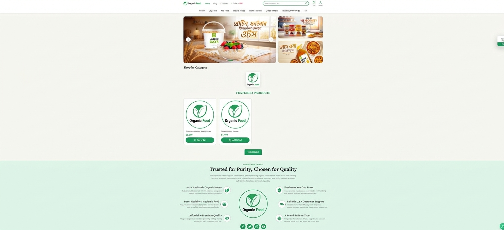
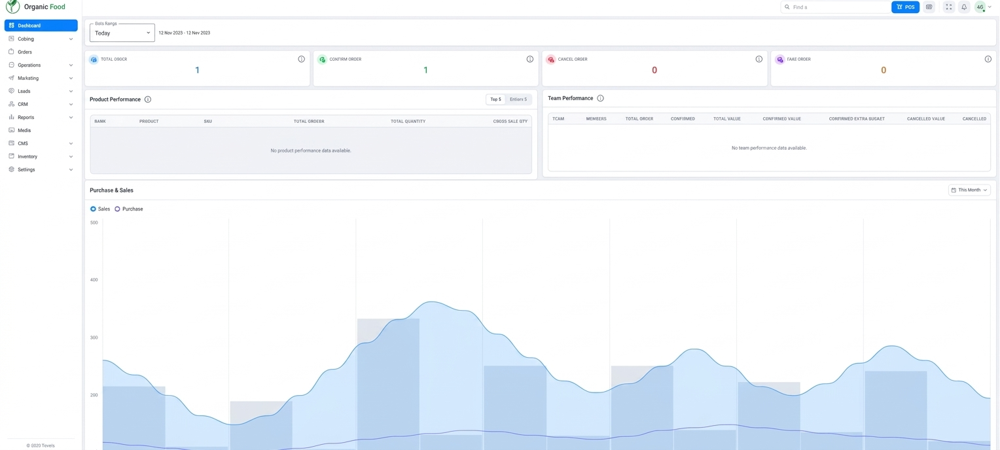
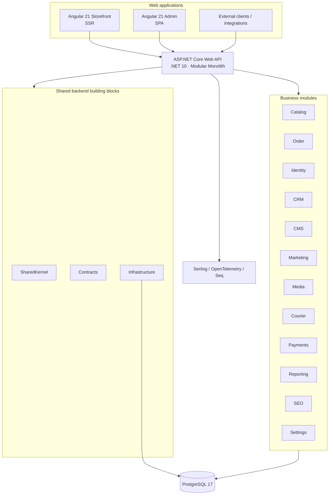
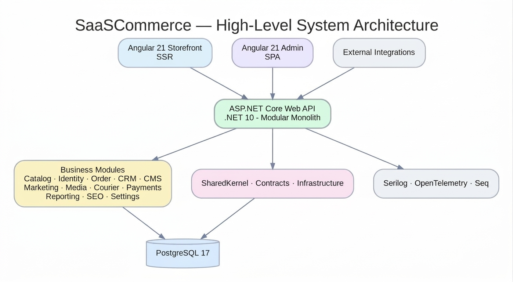

# SaaSCommerce — Full-Stack E-Commerce Platform

A modular e-commerce platform built with **.NET 10, Angular 21, and PostgreSQL**. The solution separates the customer-facing storefront, operations-focused administration experience, and modular backend while keeping their API contracts explicit.

> **Portfolio showcase:** This repository contains project documentation and selected application screenshots only. Application source code and the original development repositories remain private.

## Application Preview

| Storefront | Admin Dashboard |
|---|---|
|  |  |
| Angular 21 SSR storefront | Angular 21 SPA administration |

## At a Glance

- **Backend:** ASP.NET Core on .NET 10 / C# 14, organized as a Modular Monolith.
- **Storefront:** Angular 21 with server-side rendering (SSR), responsive customer-facing UI.
- **Admin:** Angular 21 single-page application (SPA), Angular Material, permission-driven navigation and CRUD workflows.
- **Data:** PostgreSQL 17 with schema-oriented module ownership and SQL migrations managed by DbUp.
- **Application patterns:** Clean Architecture per module, CQRS with MediatR, FluentValidation, and explicit cross-module contracts.
- **API contract:** OpenAPI document consumed by generated Angular clients through `ng-openapi-gen`.
- **Observability:** Serilog, OpenTelemetry, and Seq.
- **Testing:** xUnit, NSubstitute, Shouldly, Testcontainers, and NetArchTest.

## System Architecture

See [Architecture Overview](docs/architecture-overview.md) and the [editable Mermaid diagram](assets/architecture/system-architecture.md).

## Main Capability Areas

- **Storefront:** customer-facing product discovery and shopping experience.
- **Catalog:** product, category, brand, and unit management.
- **Orders:** cart, checkout, order lifecycle, and order operations (documented in the backend domain model).
- **Identity & access:** customer/admin identity, authentication, roles, permissions, and permission-based authorization.
- **CMS & media:** banners, blog/content pages, landing pages, galleries, and media handling.
- **CRM:** customer profiles and customer-management capabilities.
- **Marketing:** offers, campaigns, coupons, referrals, affiliates, and SEO-related capabilities.
- **Operations & reporting:** courier workflows, reporting, dashboards, and platform settings.

The detailed list distinguishes documented domain capabilities from what is visible in the supplied screenshots. See [Feature Overview](docs/features.md).

## Technology Stack

See [Technology Stack](docs/technology-stack.md) for the framework versions, backend libraries, frontend approach, persistence strategy, and testing tools.

## Engineering Highlights

1. **Module boundaries:** business modules do not reference one another directly; cross-module interaction is expressed through shared contracts.
2. **CQRS:** commands and queries are handled through MediatR, keeping write and read use cases explicit.
3. **Validation pipeline:** FluentValidation is integrated into the application pipeline.
4. **Database change management:** DbUp executes versioned SQL migration scripts; EF Core is used for persistence/query work, not EF schema migrations.
5. **Permission-driven administration:** route guards, UI permission directives, and a navigation model based on the signed-in user's permissions.
6. **Generated API clients:** Angular applications consume the OpenAPI contract through `ng-openapi-gen` rather than hand-maintained API DTOs.
7. **Observability and tests:** structured logs, telemetry, unit tests, integration-test infrastructure, and architecture rules.

## Documentation

- [Architecture Overview](docs/architecture-overview.md)
- [Feature Overview](docs/features.md)
- [Technology Stack](docs/technology-stack.md)
- [Screenshots & Evidence](docs/screenshots.md)
- [Security & Public Showcase Scope](docs/security-and-showcase-scope.md)

## Project Status & Evidence

The screenshots in this repository were captured from the locally running storefront (`localhost:4200`) and admin dashboard (`localhost:4201`) on **12 November 2026**. They demonstrate that these two Angular applications rendered locally at capture time. They are not a claim that every feature, automated test, or production deployment has been independently verified by this portfolio repository.

## About This Showcase

This public repository is intentionally documentation-only. It does not include the private application source, deployment automation, environment files, credentials, internal engineering notes, or private repository/submodule URLs.
