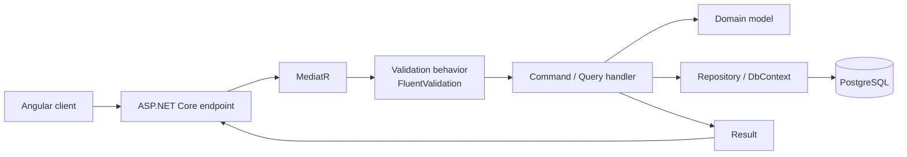

# Architecture Overview

SaaSCommerce is structured as a **Modular Monolith**. A single ASP.NET Core host composes business modules, while each module owns its domain and persistence concerns. The design emphasizes explicit boundaries and allows deployment topology to evolve without making the current application a collection of independently deployed microservices.

## Logical Layers

| Layer | Responsibility |
|---|---|
| Host / Composition Root | Application startup, dependency injection, middleware, authentication, module registration, and API hosting. |
| Business Modules | Domain entities, use cases, endpoints, and module-specific persistence. |
| SharedKernel | Base domain types, CQRS abstractions, value objects, and provider interfaces. |
| Contracts | Cross-module DTOs, service interfaces, routes, permissions, and integration-event contracts. |
| Infrastructure | Concrete persistence, authentication, middleware, caching, health checks, and shared technical implementations. |

## Module Boundaries

The backend guidance defines a strict dependency direction:

- A business module may depend on `SharedKernel`, `Contracts`, and approved shared infrastructure abstractions.
- A business module must not take a direct project dependency on another business module.
- Cross-module communication uses the shared contract surface rather than reaching into another module's internals.
- The shared kernel does not depend upward on business modules.

## Request & Use-Case Flow

## Data & Persistence

- **Primary database:** PostgreSQL 17.
- **Schema ownership:** business modules use module-oriented database schemas.
- **Migrations:** DbUp with versioned raw SQL scripts. EF Core migrations are not the schema migration mechanism.
- **ORM usage:** EF Core is used for persistence/query operations.
- **Caching:** the current backend guidance specifies a PostgreSQL-backed distributed cache (`PostgresDistributedCache`) and PostgreSQL-backed specialized stores. Do not describe the current implementation as Redis caching.

## Authentication & Authorization

The backend uses ASP.NET Core Identity with customer/admin identity separation, JWT authentication, and permission-based RBAC. The admin application uses server-managed HttpOnly authentication cookies; browser JavaScript does not read access or refresh tokens. Admin routes and UI actions are guarded by permission metadata.

## Frontend Integration

- Storefront: Angular 21 with SSR.
- Admin: Angular 21 SPA with Angular Material 21.
- Both applications use `ng-openapi-gen` to generate TypeScript API services and models from the backend OpenAPI document.
- The admin uses standalone components, lazy-loaded feature routes, Angular Signals for local/synchronous state, and RxJS for asynchronous streams.

## Observability

The backend uses Serilog and OpenTelemetry, with Seq as a log viewer/observability component.

## Architecture Diagram

See [system-architecture.md](../assets/architecture/system-architecture.md) for the editable Mermaid source.
