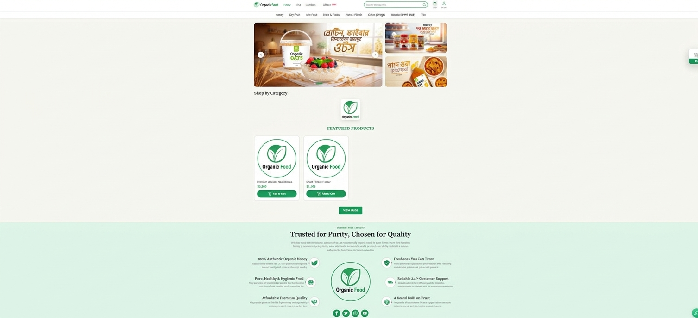
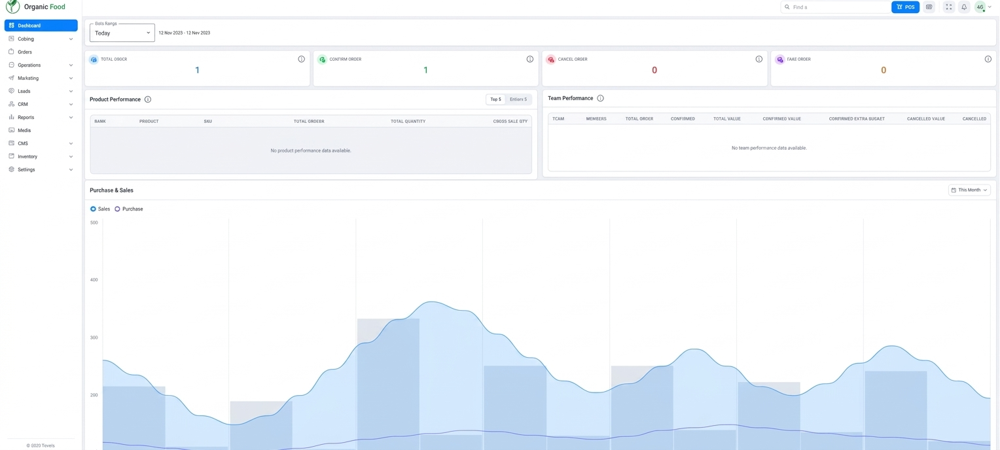

# Screenshots & Evidence

The screenshots below were captured from the locally running applications on 12 November 2026. Browser chrome was cropped; application content was not redesigned.

## Storefront Home

Visible areas include the branded navigation, promotional content, category section, featured products, add-to-cart controls, and the brand/value proposition section.

## Admin Dashboard

Visible areas include the admin sidebar, date range, order summary cards, product/team performance panels, and purchase/sales chart.

## What These Screenshots Prove

They show that the Storefront at `localhost:4200` and Admin at `localhost:4201` rendered in the local development environment at capture time. They do not independently prove production deployment, complete API coverage, payment-provider operation, or completion of every documented feature.
